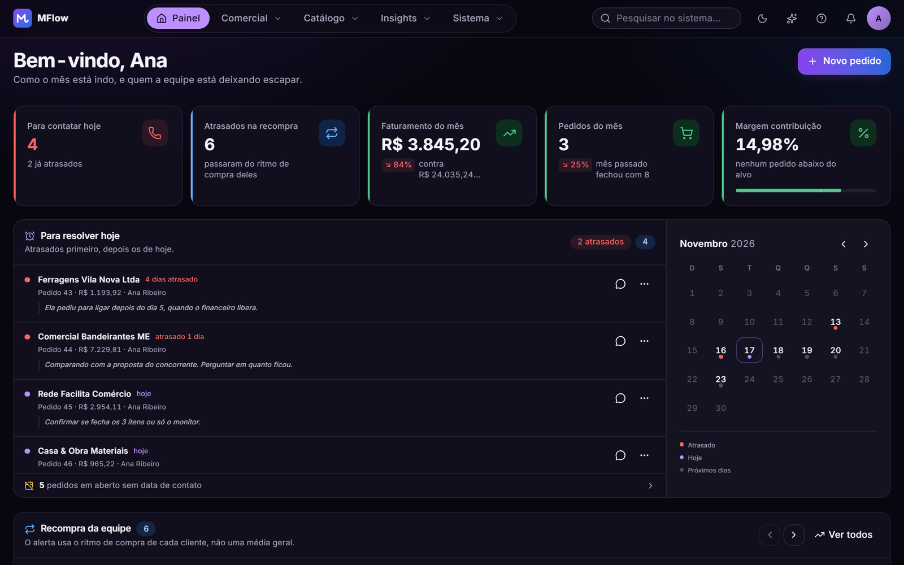
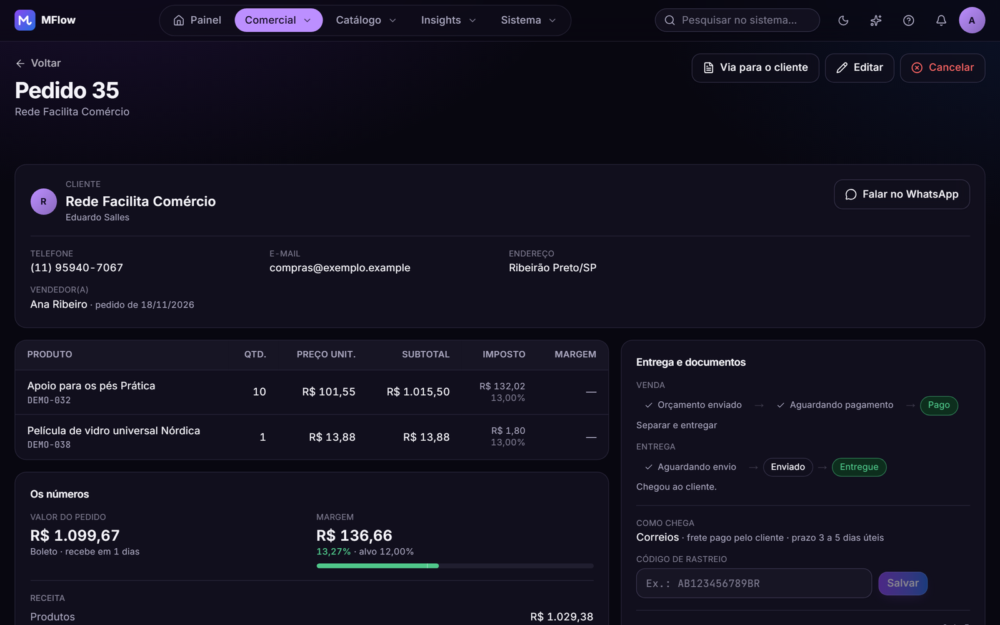
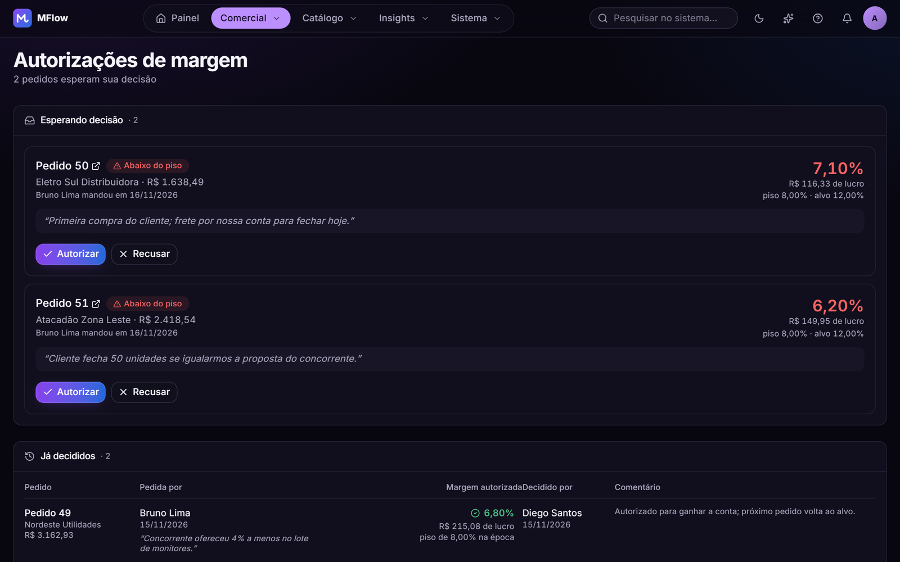
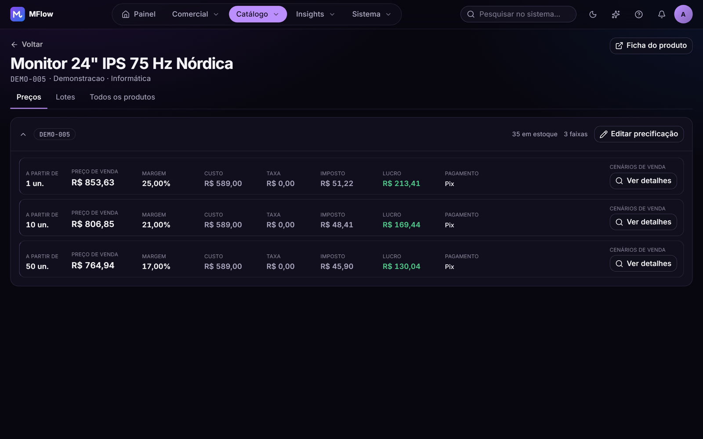
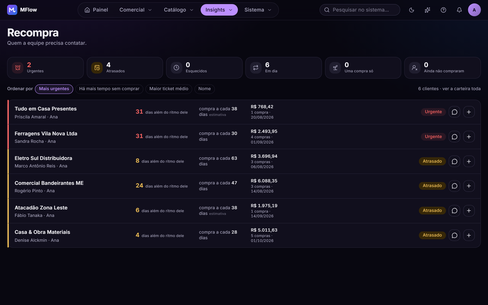
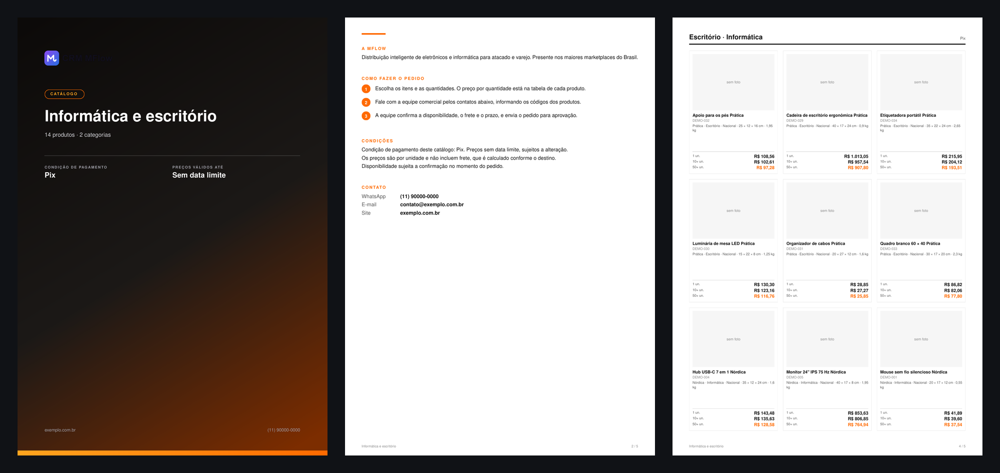
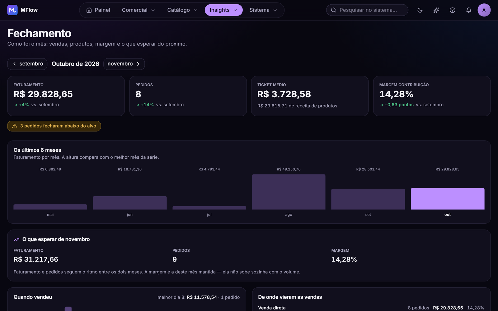
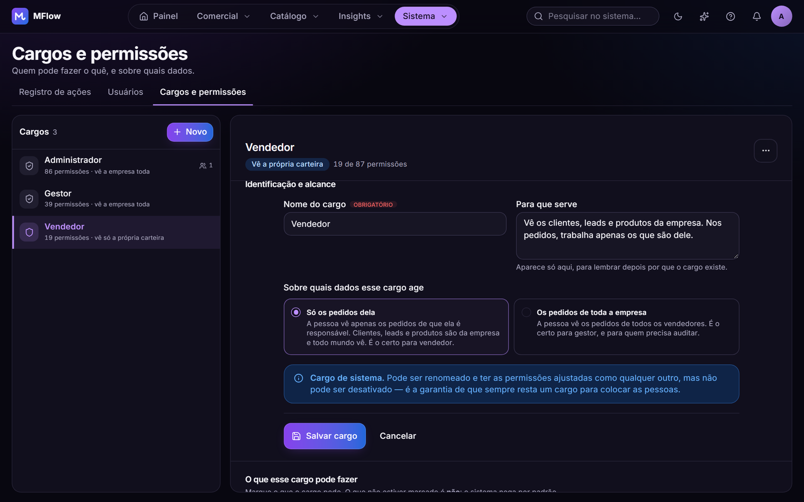
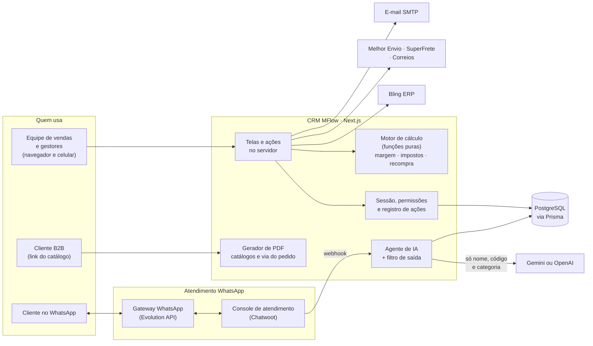

# CRM MFlow

**CRM de vendas B2B que mostra a margem real de cada pedido antes de ele fechar e diz à equipe quem ligar hoje.**

---

## O problema

Uma distribuidora que vende para outras empresas por WhatsApp, e-mail e telefone costuma perder dinheiro em lugares que nenhum CRM genérico enxerga:

- **Margem descoberta tarde demais.** O vendedor dá desconto para fechar, o frete sai por conta da empresa, a maquininha cobra a taxa do parcelamento e os impostos variam por estado e regime. A conta só aparece no fechamento do mês, quando a venda já foi feita no prejuízo.
- **Desconto sem régua.** Cada vendedor decide sozinho quanto pode baixar. Não há um piso que trave a venda ruim nem registro de quem autorizou a exceção.
- **Recompra esquecida.** O cliente que comprava todo mês parou de comprar e ninguém percebeu. A carteira esfria em silêncio.
- **Lead sem resposta fora do expediente.** A mensagem que chega às 21h só é lida no dia seguinte, quando o comprador já fechou com outro fornecedor.
- **Retrabalho entre sistemas.** O pedido é digitado no CRM, de novo no ERP, e o catálogo é montado à mão em planilha ou PDF a cada cliente.
- **LGPD e auditoria no improviso.** Ninguém sabe quem alterou um preço ou um cadastro, e um pedido de exclusão de dados não tem procedimento.

## A solução

O CRM MFlow foi construído sob medida para essa operação. Ele registra leads, clientes, interações e pedidos, e calcula na hora, enquanto o pedido é montado, quanto aquela venda realmente deixa de margem depois de impostos, frete, taxa do meio de pagamento e desconto.

Em cima desse cálculo, o sistema aplica as regras comerciais da empresa: margem alvo por faixa de valor, piso que bloqueia a venda, autorização do gestor com registro de quem liberou e quanto. Ele também acompanha o ritmo de compra de cada cliente e monta a fila de quem deve ser procurado hoje.

No WhatsApp, inclusive fora do horário comercial, um agente de IA atende, entende o que o cliente procura e deixa o lead qualificado para a equipe. Ele não tem acesso a preço nem a custo: só a nomes e categorias do catálogo.

---

## Funcionalidades

### Pedido com margem calculada na hora

- Montagem do pedido com cliente, produtos, quantidades, desconto, frete e meio de pagamento. A margem de cada item e do pedido é recalculada a cada alteração.
- **Resumo flutuante** com preço, unidades e margem, sempre visível enquanto o vendedor ajusta o preço linha a linha.
- **"Quanto de desconto cabe"**: o sistema mostra dois números, o desconto que mantém a margem alvo e o máximo que ainda não fura o piso.
- Frete com três formas (retirada, cotação automática ou valor informado) e com quem paga: frete pago pela empresa entra como custo e reduz a margem; frete pago pelo cliente não altera a margem do produto.
- Meio de pagamento (Pix direto, Pix pela maquininha, boleto e cartão à vista ou parcelado em até 12x), com a escolha de quem absorve os juros do parcelamento. A taxa incide sobre o que passa na maquininha e é descontada da margem.
- Ciclo do pedido de ponta a ponta (orçamento, pagamento, entrega e nota), com via do pedido em PDF, comprovantes de entrega, código de rastreio e exportação em CSV.
- Comissão de representante: a bonificação de quem indicou o cliente é calculada automaticamente no pedido.

### Trava de margem e autorização do gestor

- **Margem alvo por faixa de valor do pedido** (padrão de fábrica: de 15% em pedidos pequenos a 10% nos maiores), configurável pela tela. Abaixo do alvo, o sistema avisa em amarelo e deixa fechar.
- **Piso de margem** (padrão de 8%), aplicado ao pedido **e** a cada item. Abaixo dele, o pedido não fecha.
- Quem não tem permissão para furar o piso envia o pedido para **autorização**. O gestor vê a fila de pedidos pendentes e o histórico das decisões anteriores na mesma tela, e libera ou recusa confirmando com um **PIN pessoal**.
- O histórico guarda quem autorizou, quanto e por quê. Se o pedido for editado depois e a margem cair, a autorização deixa de valer.

### Precificação com impostos por estado e regime

- Motor de precificação para **Simples Nacional** e **Lucro Real**, com **ICMS, ICMS-ST, DIFAL, IPI, PIS e COFINS**, crédito de ICMS sobre o frete e a taxa do meio de pagamento.
- Preço calculado para três destinos fiscais (São Paulo, Sul e Sudeste, demais estados), com até cinco faixas de preço por quantidade para cada produto.
- Imposto calculado guia por guia, como a empresa realmente paga, e não por um coeficiente arredondado. A tela do pedido e a tela de precificação usam exatamente a mesma conta.
- **Precificação em lote**: um cenário aplica a margem desejada a uma seleção de produtos de uma vez.
- Cadastro fiscal por loja e por grupo de empresas, com vigência: um orçamento antigo continua explicável depois que uma alíquota muda.

### Recompra: quem ligar hoje

- Cada cliente tem o **próprio ritmo de compra**, calculado a partir do histórico de pedidos dele, e não por uma média geral da empresa.
- A fila de recompra mostra quem já passou do ritmo, em quantos dias, e separa o que está atrasado do que está urgente.
- O painel do vendedor abre com essa fila e com a agenda do dia (próximos contatos e lembretes), em que é possível adiar ou registrar o contato sem sair da tela.

### Agente de IA no WhatsApp

- Integração com WhatsApp por um console de atendimento próprio da empresa. Mensagem nova de número desconhecido vira lead automaticamente; de cliente da base, é anotada no cadastro dele.
- **Agente virtual** que se apresenta como assistente virtual, conversa de forma natural e coleta o que a equipe precisa para a primeira ligação já ser de venda: nome, empresa, o que procura (associado a um item ou linha do catálogo), quantidade, aplicação, prazo e endereço.
- Conhece o **horário comercial** da empresa (horário e dias configuráveis, no fuso de São Paulo). Dentro do expediente, entrega a conversa à equipe ao concluir o atendimento; fora dele, à noite, no fim de semana ou no feriado, continua atendendo, coleta o que falta e informa quando a equipe volta, em vez de deixar o cliente sem resposta.
- **Sem acesso a preço ou custo.** O modelo recebe só nome, código e categoria dos produtos. Disponibilidade é informada pelo sistema, não pelo modelo, e só como "pronta-entrega" ou "sob encomenda".
- Toda resposta passa por um **filtro determinístico** antes de sair: valores em dinheiro, promessas de prazo, frete grátis e compromissos comerciais são barrados e substituídos por uma frase segura.
- Quando um vendedor assume a conversa, o agente para de responder.
- Provedor de IA configurável: Google Gemini ou OpenAI, com modelos de reserva quando o principal está indisponível.

### Catálogos comerciais e técnicos

- **Catálogo comercial** com link próprio para o cliente: até dez catálogos com mix de produtos diferentes, com validade e link que pode ser desligado a qualquer momento.
- **PDF em A4** com capa, contracapa, índice navegável por categoria e nove produtos por página, cada um com foto, descrição e até cinco faixas de preço vindas da precificação.
- **Catálogo técnico**, montado em cinco etapas, organizado por tipo de produto, com ficha técnica e foto, sem preço por padrão. Também gera PDF e página pública.

### Integrações

- **Bling (ERP)**: conexão por CNPJ; importação do catálogo (somente leitura); criação do cliente e do pedido de venda na conta do Bling, com baixa de estoque; e leitura da nota fiscal emitida pelo financeiro, que fica disponível para download no pedido.
- **Transportadoras**: cotação simultânea em Melhor Envio, SuperFrete e contrato próprio dos Correios, para o vendedor escolher a melhor opção. O sistema só cota; não compra etiqueta.
- **E-mail (SMTP)**: convite de novos usuários e recuperação de senha.
- **Planilha**: importação de produtos por CSV a partir de um modelo baixado pela tela.

### Gestão

- **Painel** que muda conforme quem abre: o vendedor vê a agenda e a recompra dele; o gestor vê o mês da equipe e quem está escapando.
- **Metas mensais** de faturamento, pedidos e margem, com comparação entre os dois últimos meses fechados.
- **Fechamento do mês**: o que saiu, quais produtos, a que margem, projeção para o mês e sugestão de reposição de estoque.
- **Conversão de leads**: quanto virou cliente, por qual canal chega quem compra e por que se perde.
- Busca global, central de notificações, central de ajuda com tour guiado por tela e tema claro e escuro.

### Permissões, auditoria e LGPD

- **Cargos e permissões editáveis pela tela**: 87 permissões em 11 grupos, no padrão ver, criar, editar e excluir, mais ações sensíveis com nome próprio (ver custo, furar o alvo de margem, autorizar margem, cancelar pedido, transferir cliente, excluir dados pessoais, exportar relatórios).
- Ajuste de permissão por pessoa, que prevalece sobre o cargo. Cada cargo enxerga só a própria carteira ou a empresa inteira, e esse filtro é aplicado **na consulta ao banco**, não apenas escondido na tela.
- **Registro de ações** (auditoria) com o valor antigo e o novo de cada campo alterado, inclusive tentativas recusadas.
- **Retenção de 12 meses** do registro de ações, com expurgo automático.
- **Exclusão de dados a pedido do titular (LGPD)**: apaga a identificação do cliente na ficha e também nas linhas de auditoria de cliente, pedido e lead. Os pedidos ficam sem dono identificável e a nota fiscal é mantida por obrigação legal.
- Política de privacidade, termos de uso e encarregado de dados configuráveis pela tela.

---

## Arquitetura

- **Aplicação (Next.js, App Router)**: telas renderizadas no servidor e ações de servidor. Toda página e toda ação conferem a sessão e a permissão no banco. O filtro de borda só barra quem não tem sessão válida; ele não é a proteção final.
- **Motor de cálculo**: margem, desconto máximo, impostos, precificação, comissão e recompra são funções puras, sem acesso a banco. O pedido, a precificação e os relatórios chamam as mesmas funções.
- **Banco (PostgreSQL + Prisma)**: 55 tabelas e 124 migrações versionadas. Dinheiro em centavos inteiros e quantidade em milésimos.
- **Atendimento**: gateway de WhatsApp e console de atendimento rodam em contêineres próprios. O console avisa o CRM a cada mensagem, o CRM cria ou atualiza o lead e o agente responde pela mesma conversa.
- **Integrações externas**: Bling por OAuth e por CNPJ, transportadoras só para cotação, e-mail para convites e recuperação de senha.
- **Implantação**: Docker em VPS atrás do Traefik, com HTTPS. A publicação é feita por um comando, que confere o domínio, envia o código, sobe o sistema e verifica que ele respondeu.

---

## Decisões técnicas

1. **Regra comercial fica no código, não na IA.** Instruir o modelo a "não falar preço" não é trava. O agente nunca recebe preço nem custo, e cada resposta passa por um filtro determinístico que barra valores, prazos e promessas antes de sair. A fronteira do que pode ir para o modelo está escrita campo a campo e coberta por teste.
2. **Um só cálculo para a mesma pergunta.** Margem, imposto e recompra são funções puras compartilhadas por todas as telas. O imposto é a soma das guias arredondadas, como a empresa paga de fato, e não um percentual aproximado: duas contas diferentes já tinham mostrado a mesma venda com margens diferentes em duas telas.
3. **Dinheiro em centavos, percentual que nunca exagera.** Valores monetários são inteiros, sem erro de ponto flutuante. Percentual na tela é truncado, nunca arredondado para cima: uma margem de 7,999% não pode aparecer como "8,00%" ao lado do aviso de piso de 8%.
4. **Permissão é dado, e o filtro está na consulta.** Cargos e permissões vivem no banco e se editam pela tela; o código mantém só o catálogo das permissões que ele confere. O ajuste por pessoa tem três estados (segue o cargo, concedida, negada), para que uma permissão retirada não volte em silêncio numa promoção de cargo.
5. **Auditoria que cumpre a LGPD.** O registro de ações guarda o valor antigo e o novo de cada campo, porque sem o antigo não há como desfazer um erro. Por isso ele tem prazo de 12 meses com expurgo automático, e a exclusão de dados do titular alcança também as linhas de auditoria. Credenciais de integrações ficam cifradas no banco (AES-256-GCM), com a chave fora dele.
6. **Operação irreversível fica fora do automático.** O CRM cota frete mas não compra etiqueta, lê a nota fiscal mas não a emite, e importa o catálogo do ERP em modo somente leitura. Nada é apagado de verdade: registros são desativados e o histórico é preservado. Cancelar um pedido (fato comercial, que entra na estatística de perdas) é diferente de excluir um pedido de teste.

---

## Tecnologias

| Camada | Tecnologias |
|---|---|
| Interface | Next.js 16 (App Router), React 19, TypeScript, Tailwind CSS 4, Radix UI, Lucide |
| Servidor | Server Components e Server Actions do Next.js, Zod para validação |
| Banco de dados | PostgreSQL 17, Prisma 7 com migrações versionadas |
| Autenticação | Sessão em JWT (jose) com invalidação por instante, senhas e PIN com scrypt, freio progressivo contra tentativas de login |
| Documentos | @react-pdf/renderer (catálogos e via do pedido), sharp (imagens) |
| IA | Google Gemini ou OpenAI, configurável, com modelos de reserva |
| Atendimento | Evolution API (WhatsApp) e Chatwoot, em contêineres próprios |
| Integrações | Bling (OAuth), Melhor Envio, SuperFrete, Correios, SMTP (Nodemailer) |
| Testes | Vitest (unidade e integração com PostgreSQL real), Playwright para conferência visual das telas |
| Infraestrutura | Docker, Docker Compose, Traefik com HTTPS, VPS |

---

## Qualidade e segurança

- **2.020 testes de unidade**, em 129 arquivos, cobrindo cálculos de margem, impostos, precificação, recompra, permissões, filtro do agente de IA, horários, PDFs e regras de pedido.
- **1.058 testes de integração** em 79 arquivos, que rodam contra um banco PostgreSQL separado: visibilidade entre vendedores, exclusão de dados LGPD, pedido abaixo do piso e autorização de margem, fila de recompra, credenciais cifradas, atendimento do agente de IA, entre outros.
- Verificação completa antes de cada entrega: tipos, lint, testes e build de produção.
- Permissão conferida no servidor e na consulta ao banco; sessão invalidada ao sair e ao trocar a senha, em todos os aparelhos.
- Limite de requisições por IP na página pública do catálogo técnico e fila única para o trabalho pesado de montagem, preço e PDF.
- Registro de ações com retenção de 12 meses e exclusão de dados do titular que alcança a auditoria.
- Segredos fora do repositório; credenciais de terceiros cifradas no banco; o servidor de produção se recusa a subir sem a chave de cifra.

---

## Status

O CRM nasceu para uma operação real de vendas B2B e está em uso nela. O **CRM MFlow** é a edição de produto: identidade visual MFlow, sem marca nem dados de outra empresa, com assistente de primeiro acesso pelo navegador e publicação em VPS por um comando, pronta para ser implantada em novas empresas.

### Números (conferidos no código)

| Item | Quantidade |
|---|---|
| Testes de unidade | 2.020 passando |
| Testes de integração com banco real | 1.058 |
| Permissões configuráveis | 87, em 11 grupos |
| Páginas da aplicação | 88 |
| Tabelas no banco | 55 modelos, 124 migrações |

---

Projeto desenvolvido por **Matheus Silva · MFlow**
[mflowstudio.com.br](https://mflowstudio.com.br) · [github.com/portfolio-mflow](https://github.com/portfolio-mflow)

> O código-fonte é privado. Demonstração disponível mediante contato.
